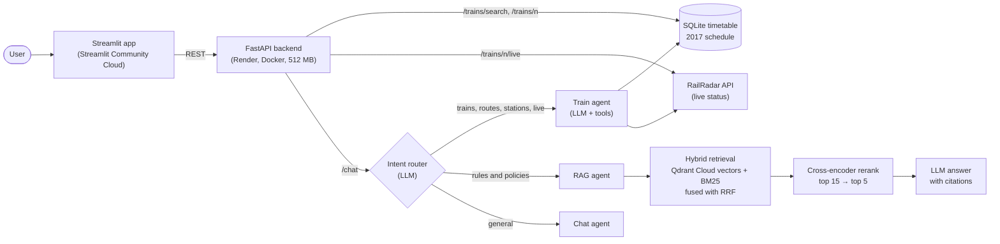

# 🚆 AI Indian Rail Travel Assistant

**Live app:** https://ai-indian-rail-travel-assistant-2txkfjep3a8dribxmlxfcv.streamlit.app/
**API:** https://ai-indian-rail-travel-assistant.onrender.com · [API docs (Swagger)](https://ai-indian-rail-travel-assistant.onrender.com/docs)

> Hosted on free tiers: the backend sleeps after ~15 minutes without traffic, so the first request can take up to a minute.

---

## Purpose

Information about Indian Railways is spread across timetables, IRCTC FAQs and rule books. This project puts it behind one conversational interface:

- **Find trains** between two cities or stations, ranked by fastest, earliest, shortest distance or best overall.
- **Answer rules questions** (Tatkal, cancellation and refunds, luggage, concessions, ID proof) from six official IRCTC and Indian Railways documents, with page-level citations.
- **Track a train live**: current position, delay and next halt.
- **Chat across all three**, including follow-ups such as "which one is faster?" or "show me its route".

Every answer says where it came from: the 2017 timetable, the official documents, or live data.

---

## Architecture



| Component | Implementation |
|---|---|
| Orchestration | LangGraph: an intent router sends each message to a train agent (tool calling), a RAG agent or a chat agent |
| LLM | Google Gemini, with automatic fallback to Groq (`openai/gpt-oss-20b`) on quota errors, overload or timeouts |
| Timetable | 186k stops from the 2017 Indian Railways dataset in an indexed SQLite file; one SQL self-join finds direct trains |
| Live status | RailRadar API, optional; cached for 5 minutes and capped at a monthly request budget so the free plan (100 requests/month) is never exceeded |
| Retrieval | `BAAI/bge-small-en-v1.5` embeddings in Qdrant Cloud + BM25 keyword search, merged with Reciprocal Rank Fusion |
| Reranking | `ms-marco-MiniLM-L-6-v2` cross-encoder (int8), scoring 15 candidates down to 5 |
| Model runtime | fastembed on ONNX Runtime (no PyTorch), so the whole backend runs in under 512 MB (peak 381 MiB measured in Docker) |
| Chat memory | Last 20 messages for each of the 200 most recent conversations, in memory |
| Frontend | Streamlit: search panel, live status panel, chat panel with source labels |

---

## Evaluation

Offline evaluation lives in `eval/` and unit tests in `tests/`; neither runs in production.

### Datasets

- **`eval/datasets/rag_golden.jsonl`**: 45 hand-written questions over the six policy PDFs. Each answerable question is labelled with the document pages that contain the answer and the key facts a correct answer must state. 3 questions are deliberately unanswerable, to test refusals.
- **`eval/datasets/intent_golden.jsonl`**: 54 labelled messages across all five intents, including multi-turn follow-ups ("which one is faster?", "show me its route", "how late is it?").

### Retrieval: which pipeline stage earns its place

42 answerable questions, top 5 results, a hit counts if the retrieved chunk is from a labelled page. No LLM involved.

| Method | Hit@1 | Hit@3 | Hit@5 | MRR@5 | nDCG@5 | Recall@5 |
|---|---|---|---|---|---|---|
| BM25 only | 0.762 | 0.881 | 0.881 | 0.810 | 0.535 | 0.821 |
| Vector only | 0.786 | 0.905 | 0.929 | 0.851 | 0.583 | 0.871 |
| Hybrid (RRF) | 0.810 | 0.857 | 0.929 | 0.851 | 0.597 | 0.877 |
| **Hybrid + rerank (production)** | **0.905** | **0.976** | **0.976** | **0.937** | **0.652** | **0.931** |

The reranker adds the most: +9.5 points Hit@1 over hybrid retrieval. Scores are identical against the live Qdrant collection and an in-memory index, and identical to the original PyTorch models apart from nDCG@5 (0.655 → 0.652 with the int8 reranker).

### Intent router

54 labelled messages, one LLM call each.

| Accuracy | Macro-F1 | Preference accuracy | Latency p50 | Latency p95 |
|---|---|---|---|---|
| 1.000 | 1.000 | 1.000 | 1.48 s | 5.75 s |

All five intents (train search, train details, station search, railway rules, general chat) scored F1 1.000, including the multi-turn follow-ups. Full confusion matrix: [`eval/results/intent.md`](eval/results/intent.md).

### RAG answers (LLM judge)

45 questions through the full production pipeline; a second LLM call grades each answer against the retrieved passages and the labelled key facts.

| Metric | Value | Meaning |
|---|---|---|
| Faithfulness | 1.000 | Claims supported by the retrieved passages |
| Answer relevance | 0.983 | Answer addresses the question |
| Key-fact recall | 0.878 | Labelled key facts stated in the answer |
| Citation precision | 0.404 | Cited pages that are labelled answer pages |
| Correct refusals | 1.000 | Unanswerable questions declined (3 of 3) |
| False refusals | 0.024 | Answerable questions wrongly declined |
| Latency p50 / p95 | 2.5 s / 30.6 s | Time per answer |

Notes:

- The judge is the same Gemini model as the generator, so treat these scores as indicative rather than absolute.
- Citation precision is low by design: every answer lists all five reranked pages as sources, not only the pages the answer used.
- During this run Gemini returned 504 timeouts 5 times and Groq answered instead; those timeouts cause the p95 latency. 1 of the 45 questions failed outright and is excluded from the averages.
- Answers missing a key fact are listed in [`eval/results/answers.md`](eval/results/answers.md).

### Tests

73 pytest tests cover station resolution, direct-train search and de-duplication, midnight-crossing durations, ranking, the SQLite build, the RailRadar client (mocked: caching, budget, rate limits, errors), chat memory, the LLM fallback, and the evaluation metrics.

---

## How to reproduce

### 1. Prerequisites

- Python 3.11 (3.10+ works)
- API keys: [Google Gemini](https://aistudio.google.com/) (required), [Qdrant Cloud](https://cloud.qdrant.io/) free cluster (required), [Groq](https://console.groq.com/) (optional fallback), [RailRadar](https://railradar.in/pricing) (optional live status)

### 2. Install

```bash
git clone https://github.com/BhanuPanuganti/AI-Indian-Rail-Travel-Assistant.git
cd AI-Indian-Rail-Travel-Assistant
python -m venv .venv
.venv\Scripts\activate          # Windows
# source .venv/bin/activate     # macOS / Linux
pip install -r requirements-dev.txt
```

### 3. Configure `.env` (project root)

```dotenv
GEMINI_API_KEY=...
QDRANT_URL=https://<your-cluster-endpoint>
QDRANT_API_KEY=...
GROQ_API_KEY=...            # optional
RAILRADAR_API_KEY=...       # optional
```

| Optional setting | Default | Purpose |
|---|---|---|
| `GEMINI_MODEL` | `gemini-3.1-flash-lite` | Primary LLM |
| `GROQ_MODEL` | `openai/gpt-oss-20b` | Fallback LLM |
| `RAILRADAR_MONTHLY_BUDGET` | `90` | Live-status requests allowed per month |
| `MODEL_THREADS` | `1` | ONNX threads; raise for faster reranking on bigger machines |
| `API_URL` (frontend) | `http://127.0.0.1:8000` | Backend URL used by the Streamlit app |

### 4. Build the vector index (once per Qdrant cluster)

```bash
python backend/rag/vector_store.py
```

This embeds the 206 pre-extracted chunks in `backend/rag/chunks.jsonl` and uploads them to Qdrant. To re-extract chunks from the PDFs first, run `python backend/rag/ingest.py`. The SQLite timetable is built automatically from the CSV on first use.

### 5. Run

```bash
uvicorn backend.main:app --port 8000        # backend
streamlit run frontend/app.py               # frontend, in a second terminal
```

Open http://localhost:8501.

### 6. Test and evaluate

```bash
pytest                                          # 73 tests, no API keys needed
python -m eval.eval_retrieval                   # retrieval comparison, no LLM calls
python -m eval.eval_retrieval --vector qdrant   # same, against the live Qdrant collection
python -m eval.eval_intent                      # intent router (1 LLM call per example)
python -m eval.eval_answers                     # RAG answers with an LLM judge (2 calls per question)
```

Results are written to `eval/results/` as JSON (per question) and Markdown (summary).

### 7. Deploy

- **Backend (Render):** New Web Service from this repo, runtime Docker, free instance, health check path `/health`. Set the `.env` variables as environment variables. The image build creates the SQLite database and downloads the ONNX models.
- **Frontend (Streamlit Community Cloud):** New app with main file `frontend/app.py`, and the secret `API_URL = "https://<your-service>.onrender.com"`.

To check the 512 MB limit locally: `docker build -t rail-backend .` then `docker run --memory=512m --env-file .env -p 8000:8000 rail-backend`.

---

## Limitations

- The timetable is a static **2017** schedule: trains, timings and running days may have changed, and only direct trains are found. Always confirm on [IRCTC](https://www.irctc.co.in/) before travelling.
- Live status depends on RailRadar, a crowdsourced third-party service, and its free plan allows about 100 lookups a month.
- Chat history is in memory and resets when the backend restarts or sleeps.

More detail on the design is in [`docs/architecture.md`](docs/architecture.md) and [`docs/rag-pipeline.md`](docs/rag-pipeline.md).

## License

See [LICENSE](LICENSE).
