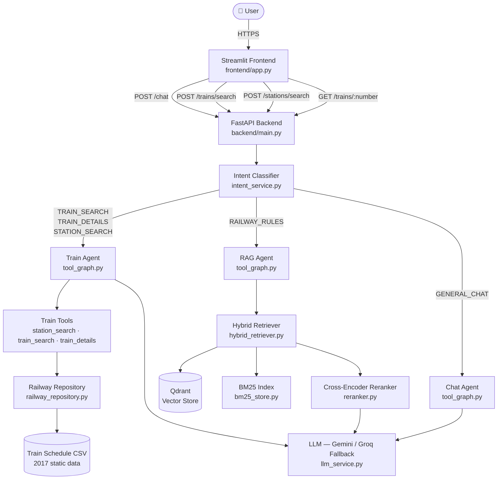
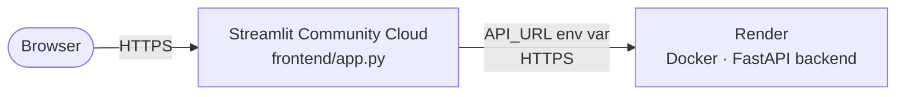
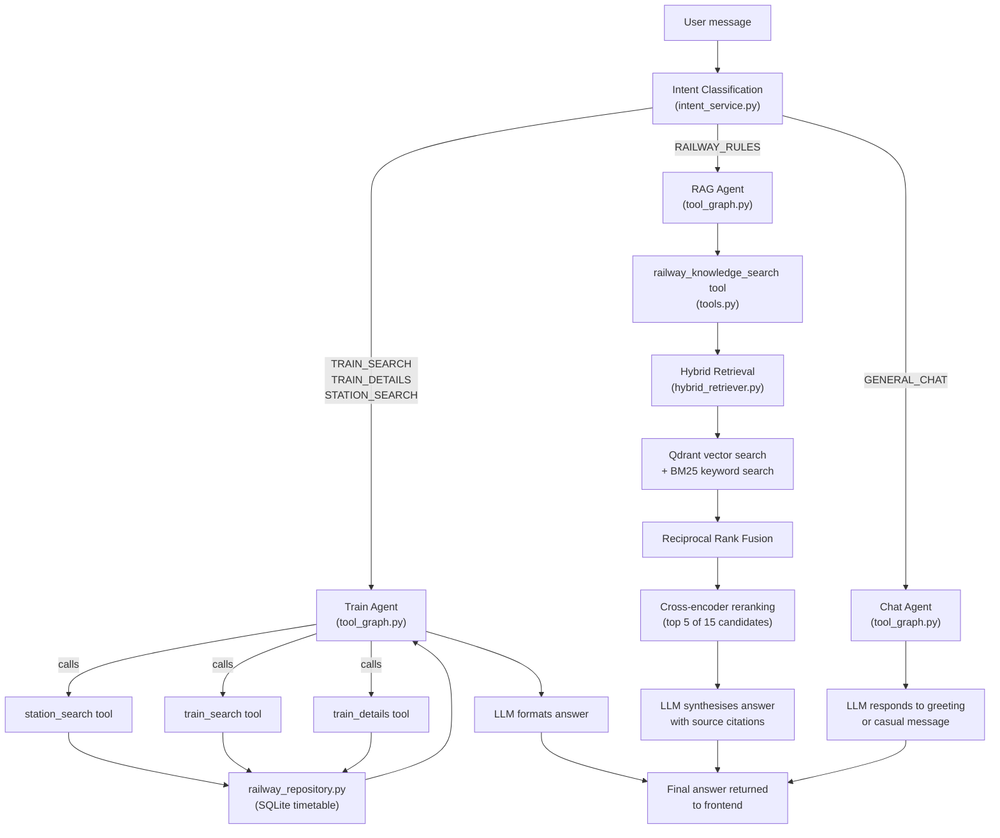

# 🚆 AI Indian Rail Travel Assistant

> An AI-powered assistant for Indian Railways — search trains, look up routes, and get answers to railway rules and policies through a conversational interface.

---

## Table of Contents

1. [Overview](#overview)
2. [Problem Statement](#problem-statement)
3. [Key Features](#key-features)
4. [System Architecture](#system-architecture)
5. [Tech Stack](#tech-stack)
6. [AI & RAG Pipeline](#ai--rag-pipeline)
7. [Evaluation](#evaluation)
8. [API Reference](#api-reference)
9. [Project Structure](#project-structure)
10. [Local Setup](#local-setup)
11. [Deployment](#deployment)
12. [Configuration](#configuration)
13. [Security & Repository Hygiene](#security--repository-hygiene)
14. [Limitations & Future Improvements](#limitations--future-improvements)

---

## Overview

AI Indian Rail Travel Assistant is a full-stack application that helps users interact with Indian Railways information through two complementary interfaces:

- **A structured train search form** — enter an origin, destination, and preference (fastest / shortest distance / balanced) to get a ranked list of trains with departure times, arrival times, and journey duration.
- **A conversational AI chat assistant** — ask natural-language questions about trains, routes, or official railway policies and receive grounded, contextual answers.

The backend is a FastAPI service; the frontend is a Streamlit web application. The two are deployed independently and communicate over HTTP.

---

## Problem Statement

Railway information in India is spread across multiple sources — timetables, IRCTC documents, FAQs, and rule books — making it time-consuming to find answers to common questions such as:

- Which trains run between two cities, and which is the fastest?
- What is the Tatkal booking fee and cut-off time?
- What are the cancellation and refund rules?
- What luggage is allowed, and what concessions are available?
- What documents are needed when travelling by train?

This project provides a unified, AI-assisted interface that combines a static train schedule dataset with a retrieval-augmented generation (RAG) pipeline over official IRCTC and Indian Railways documents, so users can get structured results and grounded answers in one place.

---

## Key Features

| Feature | Description |
|---|---|
| **Train search** | Search direct trains between any two cities or station codes. Returns departure time, arrival time, journey duration, and distance for each train. |
| **Train ranking** | Results can be sorted by fastest, shortest distance, or a balanced score combining both. A single recommended train is always highlighted. |
| **Station search** | Resolve a city or partial station name to matching station codes from the timetable dataset. |
| **Train route / stops** | Retrieve the full ordered stop list for any train number. |
| **Live running status (optional)** | Ask "where is 12302 right now?" or "is it running late?" to get the train's current station, delay, and next halt from the [RailRadar](https://railradar.in/docs) API. Off unless `RAILRADAR_API_KEY` is set; responses are cached and calls stop at a monthly budget, so the free 100-requests/month plan is never overrun. |
| **Conversational AI assistant** | Multi-turn chat backed by a LangGraph agent. Maintains conversation memory within a session. |
| **Intent detection & routing** | Every user message is classified into one of five intents (train search, train details, station search, railway rules, or general chat) before routing to the correct agent. |
| **RAG over official documents** | Policy questions are answered using hybrid retrieval over six official IRCTC and Indian Railways PDF documents, followed by cross-encoder reranking and an LLM synthesis step. |
| **Hybrid retrieval** | Combines dense vector search (Qdrant + BAAI/bge-small-en-v1.5) and BM25 keyword search using Reciprocal Rank Fusion (RRF). |
| **Reranking** | A `cross-encoder/ms-marco-MiniLM-L6-v2` cross-encoder reranks the 15 hybrid candidates to the top 5 most relevant chunks before passing context to the LLM. |
| **LLM fallback** | Uses Gemini as the primary LLM. Automatically falls back to Groq (LLaMA 3.1) when Gemini hits a quota limit. |
| **Source citations** | RAG answers include source document names and page numbers so users can verify information. |

---

## System Architecture

### Application Flow



### Deployment Architecture



- The **Streamlit frontend** is deployed on Streamlit Community Cloud.
- The **FastAPI backend** is deployed on Render using the provided `Dockerfile`.
- The frontend communicates with the backend exclusively via the `API_URL` environment variable / Streamlit secret.
- All API keys (`GEMINI_API_KEY`, `GROQ_API_KEY`) live only in the backend's Render environment — they are never exposed to or stored in the frontend.

---

## Tech Stack

### Frontend

| Technology | Purpose |
|---|---|
| **Streamlit** | Web UI framework — chat interface, train search form, card rendering |
| **requests** | HTTP client for calling the FastAPI backend |

### Backend

| Technology | Purpose |
|---|---|
| **Python 3.11** | Runtime (as specified in Dockerfile) |
| **FastAPI** | REST API framework |
| **Uvicorn** | ASGI server (standard extras) |
| **Pydantic / pydantic-settings** | Request/response validation and typed settings from `.env` |
| **python-dotenv** | Loads `.env` into environment on local runs |
| **SQLite** | Indexed train timetable built from the CSV; queried from disk to keep memory low |

### AI / LLM

| Technology | Purpose |
|---|---|
| **Google Gemini** (`google-genai`, `langchain-google-genai`) | Primary LLM for chat, intent classification, and RAG answer synthesis |
| **Groq / LLaMA 3.1** (`langchain-groq`) | Automatic fallback LLM when Gemini hits quota limits |
| **LangChain** (`langchain`, `langchain-core`, `langchain-community`) | Prompt building, tool definitions, document loaders |
| **LangGraph** (`langgraph`) | Multi-agent graph orchestration with in-memory conversation checkpointing |

### Retrieval / RAG

| Technology | Purpose |
|---|---|
| **Qdrant Cloud** (`qdrant-client`) | Hosted vector store for dense document retrieval |
| **BAAI/bge-small-en-v1.5** (`fastembed`, ONNX Runtime) | Embedding model used for both ingestion and query encoding |
| **BM25Okapi** (`rank-bm25`) | Keyword-based retrieval using BM25 scoring |
| **Reciprocal Rank Fusion** | Custom implementation merging vector and BM25 result lists |
| **ms-marco-MiniLM-L-6-v2** cross-encoder (`fastembed`, ONNX Runtime) | Reranker that rescores the top 15 hybrid candidates |
| **PyPDF** (`pypdf`) | PDF loading during document ingestion |
| **LangChain text splitters** | Recursive character text splitting during ingestion |

### Data

| Source | Description |
|---|---|
| `data/railway/Train_details_22122017.csv` | Static Indian Railways timetable from December 2017. Contains train numbers, names, station codes, sequence numbers, arrival/departure times, and cumulative distances (~16 MB). |
| `backend/rag/documents/*.pdf` | Six official PDFs: IRCTC e-ticket FAQ, IRCTC terms and conditions, cancellation & refund rules, luggage rules, concession rules, and Tatkal FAQ. |
| `backend/rag/chunks.jsonl` | Pre-processed and chunked text extracted from the PDFs, stored as JSON Lines. Used to build both the Qdrant vector store and the BM25 index. |

### Deployment

| Technology | Purpose |
|---|---|
| **Docker** | Containerises the FastAPI backend (`python:3.11-slim` base image) |
| **Render** | Cloud platform hosting the backend container (free 512 MB instance) |
| **Streamlit Community Cloud** | Hosts the frontend application |

---

## AI & RAG Pipeline

### How the chat assistant works

Every message sent to `POST /chat` is processed by a **LangGraph multi-agent graph** (`tool_graph.py`). Here is the full flow:



### Component explanations

**Intent detection** (`intent_service.py`)  
Before any tool is called, the user's latest message — together with the full conversation history — is passed to the LLM configured with structured output (`UserIntent`). The LLM classifies the intent into one of five categories. This allows the graph to route the message to exactly the right agent rather than blindly invoking all tools every time.

**Train Agent** (`tool_graph.py → train_agent`)  
Handles train search, train details, and station lookup. The LLM is bound to three LangChain tools: `station_search`, `train_search`, and `train_details`. It decides which tools to call based on the user's message. The LangGraph loop allows it to call tools, receive results, and continue reasoning until a final answer is ready. The agent follows a strict system prompt that prohibits inventing trains or schedules.

**Railway tools** (`tools.py` + `train_service.py` + `railway_repository.py`)  
- `station_search`: queries the CSV dataset for stations matching a city name or station code.
- `train_search`: resolves origin and destination to station codes, then finds direct trains by joining the dataset on `Train No` and filtering for correct sequence order.
- `train_details`: returns all stops of a specific train number in order.
- Train results are ranked by the `train_ranker.py` according to the user's preference (`fastest`, `shortest_distance`, or `balanced`).
- Duration calculation handles overnight journeys that cross midnight (`time_utils.py`).

**RAG Agent** (`tool_graph.py → rag_agent`)  
For policy and rules questions, the agent directly calls `railway_knowledge_search` without an LLM decision loop, saving an API call and preventing the agent from getting into an infinite loop.

**RAG pipeline** (`rag/`)  
1. **Hybrid retrieval** (`hybrid_retriever.py`): runs the query through both Qdrant (dense vector search using `BAAI/bge-small-en-v1.5` embeddings) and BM25 (keyword search using `BM25Okapi`). Results are merged using **Reciprocal Rank Fusion** — a score fusion technique that rewards documents ranked highly by both methods.
2. **Reranking** (`reranker.py`): the top 15 fused candidates are passed to a `cross-encoder/ms-marco-MiniLM-L6-v2` cross-encoder, which scores each `(query, chunk)` pair directly. The top 5 are selected.
3. **Answer synthesis** (`rag_service.py`): the 5 reranked chunks are assembled into a context prompt and sent to the LLM with a strict system prompt that prohibits inventing information. The final answer includes source document names and page numbers.

**LLM fallback** (`llm_service.py`)  
The `FallbackLLM` wrapper tries Gemini first. On any `429 / RESOURCE_EXHAUSTED / quota` error, it transparently retries with the Groq/LLaMA fallback. The fallback applies to `.invoke()`, `.bind_tools()`, and `.with_structured_output()`, making it a seamless drop-in replacement.

**Conversation memory**  
A bounded in-memory store (`conversation_store.py`) keeps each conversation's recent messages, keyed by `thread_id`, and passes them to the graph with every request. Each browser session gets a unique UUID thread. History is trimmed to the last 20 messages (always starting at a user message) and only the 200 most recently used conversations are kept. It is not persisted to disk and resets when the backend restarts.

---

## Evaluation

The project ships with an offline evaluation suite (`eval/`) and unit tests (`tests/`). None of it runs in the deployed backend, so it adds no memory or latency in production.

| Layer | What is measured | Script | LLM calls |
|---|---|---|---|
| **Retrieval** | Hit@k, MRR, nDCG@k, page Recall@k, latency — for BM25, vector, hybrid (RRF) and hybrid + rerank | `eval/eval_retrieval.py` | none |
| **Intent router** | Accuracy, macro-F1, per-intent precision/recall/F1, confusion matrix, preference accuracy, latency | `eval/eval_intent.py` | 1 per example |
| **RAG answers** | Faithfulness, answer relevance, key-fact recall, citation precision, correct/false refusal rate, latency p50/p95, LLM calls, Groq fallbacks | `eval/eval_answers.py` | 2 per question |
| **Train data layer** | Station resolution, direct-train search, de-duplication, midnight-crossing durations, ranking by preference, strict-JSON output | `tests/` (pytest) | none |

### Golden datasets

- `eval/datasets/rag_golden.jsonl` — 45 hand-written questions over the six policy PDFs. Each answerable question lists the (document, page) pairs that contain the answer and the key facts a correct answer must state; 3 questions are deliberately unanswerable from the documents to test refusals. Relevance is judged at page level, so the labels stay valid if the PDFs are re-chunked.
- `eval/datasets/intent_golden.jsonl` — 54 labelled messages across all five intents, including multi-turn follow-ups ("which one is faster?", "show me its route", "how late is it?") and ranking preferences.

### Results

<!-- EVAL_RESULTS_START -->
**Retrieval** — 42 answerable questions, top-5 results, page-level relevance:

| Method | Hit@1 | Hit@3 | Hit@5 | MRR@5 | nDCG@5 | Recall@5 |
|---|---|---|---|---|---|---|
| BM25 only | 0.762 | 0.881 | 0.881 | 0.810 | 0.535 | 0.821 |
| Vector only | 0.786 | 0.905 | 0.929 | 0.851 | 0.583 | 0.871 |
| Hybrid (RRF) | 0.810 | 0.857 | 0.929 | 0.851 | 0.597 | 0.877 |
| **Hybrid + rerank (production)** | **0.905** | **0.976** | **0.976** | **0.937** | **0.652** | **0.931** |

Each stage adds value; the cross-encoder reranker gives the largest gain (+9.5 points Hit@1 over hybrid). Scores are identical whether the vector search runs against the live Qdrant Cloud collection or the in-memory index, and the production int8 reranker matches the fp32 one on every metric except nDCG@5 (0.652 vs 0.655). Full per-question output: [`eval/results/retrieval.md`](eval/results/retrieval.md).

Intent-router and answer-quality results will be added after a full run.
<!-- EVAL_RESULTS_END -->

### Running the evaluation

```bash
pip install -r requirements-dev.txt

pytest                                   # unit tests, no API keys needed
python -m eval.eval_retrieval            # retrieval ablation, no LLM calls
python -m eval.eval_intent               # needs GEMINI_API_KEY
python -m eval.eval_answers              # needs GEMINI_API_KEY
```

Each script writes `eval/results/<name>.json` (per-question detail) and `eval/results/<name>.md` (summary tables). The retrieval and answer evals build an in-memory vector index from `chunks.jsonl` with the same embedding model and cosine distance as the Qdrant collection; add `--vector qdrant` to evaluate against the live collection. The LLM scripts throttle themselves (`--delay`) to stay within the Gemini free-tier rate limit and accept `--limit N` for a quick smoke run.

The answer judge is the same Gemini model that generates the answers, so its scores are indicative rather than absolute; the retrieval evaluation, which uses no LLM, is the objective baseline.

---

## API Reference

The FastAPI backend exposes the following endpoints. Interactive Swagger documentation is available at `/docs` when the server is running.

### Endpoint summary

| Method | Endpoint | Purpose |
|---|---|---|
| `GET` | `/` | Root — returns app name, version, and status |
| `GET` | `/health` | Health check |
| `POST` | `/stations/search` | Find stations matching a name or code |
| `POST` | `/trains/search` | Search direct trains between two locations |
| `GET` | `/trains/{train_number}` | Get full stop list for a train |
| `POST` | `/chat` | Send a message to the conversational AI assistant |

---

### `GET /`

Returns basic application metadata.

**Example response**
```json
{
  "message": "AI Indian Rail Travel Assistant",
  "version": "1.0.0",
  "status": "running"
}
```

---

### `GET /health`

Lightweight health check used by deployment platforms.

**Example response**
```json
{ "status": "healthy" }
```

---

### `POST /stations/search`

Find railway stations whose name or code matches the query string.

**Request body**
```json
{ "query": "Hyderabad" }
```

| Field | Type | Required | Description |
|---|---|---|---|
| `query` | string | Yes | City name, station name, or station code |

**Example response**
```json
{
  "query": "Hyderabad",
  "count": 3,
  "stations": [
    { "Station Code": "HYB", "Station Name": "HYDERABAD DECCAN" },
    { "Station Code": "SC",  "Station Name": "SECUNDERABAD JN" },
    { "Station Code": "NZB", "Station Name": "NIZAMABAD" }
  ]
}
```

---

### `POST /trains/search`

Search for direct trains between two cities or station codes.

**Request body**
```json
{
  "origin": "Hyderabad",
  "destination": "Chennai",
  "preference": "balanced"
}
```

| Field | Type | Required | Default | Description |
|---|---|---|---|---|
| `origin` | string | Yes | — | Origin city name or station code |
| `destination` | string | Yes | — | Destination city name or station code |
| `preference` | string | No | `"balanced"` | Ranking preference: `"balanced"`, `"fastest"`, or `"shortest_distance"` |

**Example response**
```json
{
  "origin": "Hyderabad",
  "destination": "Chennai",
  "preference": "balanced",
  "count": 4,
  "trains": [
    {
      "train_number": "12759",
      "train_name": "CHARMINAR EXP",
      "origin_code": "HYB",
      "origin_name": "HYDERABAD DECCAN",
      "destination_code": "MAS",
      "destination_name": "CHENNAI CENTRAL",
      "departure_time": "18:10:00",
      "arrival_time": "06:10:00",
      "duration_minutes": 720,
      "duration": "12h",
      "distance_km": 794.0,
      "source": "static_schedule_2017"
    }
  ],
  "recommended_train": { "...": "same shape as above" },
  "reason": "Best overall balance of speed and distance.",
  "ranking_preference": "balanced"
}
```

> **Note:** Schedule data is from December 2017. Always verify on IRCTC before booking.

---

### `GET /trains/{train_number}`

Returns the full, ordered list of stops for a given train.

**Path parameter:** `train_number` — numeric train number (e.g. `12759`)

**Example response**
```json
{
  "train_number": "12759",
  "stop_count": 18,
  "route": [
    {
      "Train No": "12759",
      "Train Name": "CHARMINAR EXP",
      "SEQ": 1,
      "Station Code": "HYB",
      "Station Name": "HYDERABAD DECCAN",
      "Arrival time": "Source",
      "Departure Time": "18:10:00",
      "Distance": "0"
    },
    { "...": "..." }
  ]
}
```

---

### `GET /trains/{train_number}/live`

Live running status from RailRadar. Requires `RAILRADAR_API_KEY`; without it the response carries `"error": "live_status_not_configured"`.

**Path parameter:** `train_number` — e.g. `12302`
**Query parameter (optional):** `date` — journey start date `YYYY-MM-DD` (the day the train left its source station); omit for the current run.

**Example response**
```json
{
  "train_number": "12919",
  "live": {
    "train_name": "Malwa SF Express",
    "status": "running",
    "delay_minutes": 4,
    "last_updated_at": "2026-11-02T14:01:51+05:30",
    "current_location": { "station_code": "UJN", "station_name": "Ujjain Jn", "status": "at-station" },
    "previous_halt": { "station_code": "DWX", "station_name": "Dewas" },
    "next_halt": { "station_code": "NAD", "station_name": "Nagda Jn" },
    "source": "RailRadar live status (crowdsourced; may be delayed or inaccurate)",
    "cached": false
  }
}
```

Errors are returned as `{"train_number": ..., "error": "<code>", "message": "..."}` with codes `train_not_found`, `train_not_running`, `live_status_quota_reached`, `live_status_busy`, `live_status_unavailable`, `live_status_unreachable` or `live_status_not_configured`.

---

### `POST /chat`

Send a message to the AI assistant. The assistant maintains per-session conversation history using `thread_id`.

**Request body**
```json
{
  "message": "What are the Tatkal booking rules?",
  "thread_id": "abc123"
}
```

| Field | Type | Required | Default | Description |
|---|---|---|---|---|
| `message` | string | Yes | — | User's message |
| `thread_id` | string | No | `"default"` | Session identifier for conversation continuity |

**Example response**
```json
{
  "message": "What are the Tatkal booking rules?",
  "response": "Tatkal booking opens 1 day before the date of journey (excluding the date of journey)...\n\n📚 Sources\n• irctc_tatkal_faq.pdf — Page 3\n",
  "thread_id": "abc123"
}
```

> Swagger UI is available at `http://localhost:8000/docs` when the backend is running locally.

---

## Project Structure

```
AI-Indian-Rail-Travel-Assistant/
├── backend/
│   ├── main.py                  # FastAPI app — all route definitions
│   ├── config.py                # Typed settings (Pydantic) — loads from .env
│   ├── chat_service.py          # Entry point for /chat — invokes LangGraph with timeout
│   ├── tool_graph.py            # LangGraph multi-agent graph (intent → routing → agents)
│   ├── intent_service.py        # LLM-based intent classification into 5 categories
│   ├── llm_service.py           # Gemini + Groq fallback wrapper (FallbackLLM)
│   ├── tools.py                 # LangChain @tool definitions: station_search, train_search,
│   │                            #   train_details, railway_knowledge_search
│   ├── train_service.py         # High-level train search helpers used by tools and routes
│   ├── train_ranker.py          # Sorts and recommends trains by preference
│   ├── railway_repository.py    # SQLite data access layer (stations, direct trains, routes)
│   ├── train_db.py              # Builds the indexed SQLite timetable from the CSV
│   ├── railradar_client.py      # Optional live running status (cached, budgeted)
│   ├── conversation_store.py    # Bounded per-conversation chat history
│   ├── time_utils.py            # Duration calculation (handles overnight journeys)
│   ├── format_utils.py          # Formats minutes into human-readable "2h 35m"
│   ├── models.py                # Pydantic models: TrainStop, TrainSearchResult,
│   │                            #   TravelIntent, ChatIntent, UserIntent
│   ├── list_models.py           # Utility script to list available Gemini models
│   └── rag/
│       ├── ingest.py            # One-time script: load PDFs → chunk → write chunks.jsonl
│       ├── vector_store.py      # One-time script: embed chunks.jsonl → Qdrant collection
│       ├── bm25_store.py        # Loads chunks.jsonl and builds an in-memory BM25 index
│       ├── retriever.py         # Dense vector retrieval via Qdrant
│       ├── hybrid_retriever.py  # Combines vector + BM25 results with RRF
│       ├── reranker.py          # Cross-encoder reranking of hybrid candidates
│       ├── rag_service.py       # Orchestrates retrieval → context building → LLM synthesis
│       ├── chunks.jsonl         # Pre-processed document chunks (committed to repo)
│       ├── documents/           # Source PDFs (6 official IRCTC/IR documents)
│       └── preload_models.py    # Downloads the ONNX models (run at Docker build time)
├── frontend/
│   └── app.py                   # Streamlit UI — search form, chat interface, train cards
├── data/
│   └── railway/
│       └── Train_details_22122017.csv   # Static train timetable dataset (~16 MB)
├── eval/
│   ├── datasets/                # Golden sets: rag_golden.jsonl, intent_golden.jsonl
│   ├── eval_retrieval.py        # Retrieval ablation (BM25 / vector / hybrid / rerank)
│   ├── eval_intent.py           # Intent router accuracy, F1, confusion matrix
│   ├── eval_answers.py          # RAG answer quality with an LLM judge
│   ├── metrics.py               # Hit@k, MRR, nDCG, recall, classification report
│   └── results/                 # Latest evaluation outputs (.json + .md)
├── tests/                       # pytest suite for the train data layer and metrics
├── Dockerfile                   # Backend Docker image (python:3.11-slim, port 8000)
├── .dockerignore                # Keeps frontend, eval, tests, docs and secrets out of the image
├── .gitignore                   # Excludes .env, .venv, the SQLite DB and model cache
├── requirements.txt             # Everything for local development
├── backend/requirements.txt     # Backend runtime only (installed in the Docker image)
├── frontend/requirements.txt    # Streamlit app only (used by Streamlit Community Cloud)
├── requirements-dev.txt         # Adds pytest for tests and evaluation
└── README.md
```

### Key file notes

| File | Notes |
|---|---|
| `backend/tool_graph.py` | The main chat pipeline. Contains intent routing, three specialist agents (train, RAG, chat), and the LangGraph state machine. |
| `backend/rag/ingest.py` | Run **once** to generate `chunks.jsonl` from the PDF documents. |
| `backend/rag/vector_store.py` | Run **once** to build the Qdrant collection from `chunks.jsonl`. |
| `backend/train_db.py` | Builds `data/railway/trains.sqlite` from the CSV (automatically on first use, and at Docker build time). |

---

## Local Setup

### Prerequisites

- Python **3.11** or later
- `pip`
- `git`
- A [Google AI Studio](https://aistudio.google.com/) API key (Gemini)
- *(Optional)* A [Groq](https://console.groq.com/) API key for LLM fallback

### 1 — Clone the repository

```bash
git clone https://github.com/<your-username>/AI-Indian-Rail-Travel-Assistant.git
cd AI-Indian-Rail-Travel-Assistant
```

### 2 — Create a virtual environment

**Windows (PowerShell)**
```powershell
python -m venv .venv
.venv\Scripts\Activate.ps1
```

**macOS / Linux**
```bash
python -m venv .venv
source .venv/bin/activate
```

### 3 — Install dependencies

```bash
pip install -r requirements.txt
```

### 4 — Configure environment variables

Create a `.env` file in the **project root** (alongside `requirements.txt`):

```dotenv
# Required
GEMINI_API_KEY=your_gemini_api_key_here
QDRANT_URL=https://your-cluster-endpoint
QDRANT_API_KEY=your_qdrant_api_key

# Optional — automatic LLM fallback when Gemini hits quota
GROQ_API_KEY=your_groq_api_key_here

# Optional — live train running status (RailRadar)
RAILRADAR_API_KEY=your_railradar_key
```

> ⚠️ **Never commit `.env` to git.** It is already listed in `.gitignore`.

### 5 — Build the RAG vector store (once per Qdrant cluster)

The `chunks.jsonl` file (pre-extracted text chunks from the PDFs) is already committed.
Create a free cluster on [Qdrant Cloud](https://cloud.qdrant.io/), put its endpoint and API key in `.env`, then upload the embeddings:

```bash
python backend/rag/vector_store.py
```

This embeds the 206 chunks with `BAAI/bge-small-en-v1.5` (via fastembed) and uploads them to the `indian_railway_knowledge` collection. Re-run it whenever you create a new cluster; free clusters are suspended and eventually deleted after a period of inactivity.

The train timetable database (`data/railway/trains.sqlite`) is built automatically from the CSV on first use; to build it explicitly run `python -m backend.train_db`.

> If you also want to re-extract chunks from the PDFs (e.g. after changing documents):
> ```bash
> python backend/rag/ingest.py
> python backend/rag/vector_store.py
> ```

### 6 — Run the backend

```bash
uvicorn backend.main:app --reload
```

The API is available at `http://127.0.0.1:8000`.  
Swagger UI: `http://127.0.0.1:8000/docs`

### 7 — Run the frontend

In a **separate terminal** (with the virtual environment active):

```bash
streamlit run frontend/app.py
```

The app opens at `http://localhost:8501`.

By default, the frontend points to `http://127.0.0.1:8000` when no `API_URL` environment variable is set. This is suitable for local development.

---

## Deployment

The project uses a **two-service deployment**:

- FastAPI backend → **Render** (Docker web service, free 512 MB instance)
- Streamlit frontend → **Streamlit Community Cloud**

### Backend — Render

1. In the [Render dashboard](https://dashboard.render.com/), choose **New → Web Service** and connect this GitHub repository.
2. Settings:

   | Setting | Value |
   |---|---|
   | Branch | `main` |
   | Language / Runtime | Docker (uses the root `Dockerfile`) |
   | Root directory | *(empty)* |
   | Instance type | Free |
   | Health check path | `/health` (under **Advanced**) |

3. Add environment variables:

   | Variable | Value |
   |---|---|
   | `GEMINI_API_KEY` | Your Gemini API key |
   | `QDRANT_URL` / `QDRANT_API_KEY` | Your Qdrant Cloud cluster endpoint and key |
   | `GROQ_API_KEY` | Groq key (optional fallback) |
   | `RAILRADAR_API_KEY` | RailRadar key (optional live status) |

   Render sets `PORT` itself; the container listens on it.
4. Create the service. Render builds the image, which also builds the SQLite timetable and downloads the ONNX models, so the server starts without network downloads. With auto-deploy on, every push to `main` redeploys.
5. Verify:
   - `GET https://<service>.onrender.com/health` → `{ "status": "healthy" }`
   - `GET https://<service>.onrender.com/docs` → Swagger UI

> **Free-tier behaviour:** the service sleeps after about 15 minutes without traffic, and the first request afterwards waits for it to start again. The free instance also has only a fraction of a CPU, so RAG answers are slower than locally.

#### Memory budget (512 MB)

The backend was slimmed to fit the free instance:

| Change | Effect |
|---|---|
| `sentence-transformers` / PyTorch → **fastembed** (ONNX Runtime), same `bge-small-en-v1.5` and MiniLM cross-encoder (int8 export) | Retrieval metrics unchanged apart from nDCG@5 0.655 → 0.652 (see [Evaluation](#evaluation)); no torch in the image; reranking 2× faster |
| ONNX Runtime CPU memory arena off, 1 inference thread, reranking in batches of 4 | Memory stays flat across queries; no temporary spike when scoring 15 passages |
| pandas DataFrame → **SQLite** file built from the CSV at image build time | Timetable is read from disk; results verified identical to the pandas version |
| LangGraph `MemorySaver` → bounded conversation store (last 20 messages × 200 conversations) | Chat history can no longer grow without limit |
| Backend-only `backend/requirements.txt` in the image | No Streamlit, pandas, LangChain community or PDF tooling installed |

Tested in Docker with a hard 512 MB limit (`--memory=512m`): after 40 train-endpoint requests and four chat turns (RAG, train search, follow-up) the container's peak memory was **381 MiB**, with no OOM kill. The previous build needed ~770 MB and was OOM-killed on its first RAG question under the same limit.

### Frontend — Streamlit Community Cloud

1. Go to [share.streamlit.io](https://share.streamlit.io/) and sign in with GitHub.
2. Click **New app**, select your repository and `main` branch.
3. Set the **Main file path** to:
   ```
   frontend/app.py
   ```
   Streamlit installs `frontend/requirements.txt` (Streamlit and requests only).
4. Under **Advanced settings → Secrets**, add:
   ```toml
   API_URL = "https://<service>.onrender.com"
   ```
   This points the deployed frontend to your Render backend.
5. Click **Deploy**.

> ⚠️ Do **not** add `GEMINI_API_KEY`, `GROQ_API_KEY`, `QDRANT_API_KEY` or `RAILRADAR_API_KEY` to the Streamlit secrets. They belong only in the Render backend environment. The frontend only needs `API_URL`.

---

## Configuration

| Variable | Required | Used By | Description |
|---|---|---|---|
| `GEMINI_API_KEY` | **Yes** | Backend | Google Gemini API key. Primary LLM for all agents. |
| `GEMINI_MODEL` | No | Backend | Gemini model name. Defaults to `gemini-3.1-flash-lite`. |
| `GROQ_API_KEY` | No | Backend | Groq API key. Enables automatic LLM fallback on quota errors. Leave empty to disable. |
| `GROQ_MODEL` | No | Backend | Groq model name. Defaults to `llama-3.1-8b-instant`. |
| `RAILRADAR_API_KEY` | No | Backend | [RailRadar](https://railradar.in/pricing) API key. Enables live running status. Leave empty to disable. |
| `RAILRADAR_MONTHLY_BUDGET` | No | Backend | Maximum live-status requests per month made by one backend process. Defaults to `90` (the free plan allows 100). |
| `RAILRADAR_MIN_REMAINING` | No | Backend | Stop calling when RailRadar reports this many requests or fewer left this month. Defaults to `5`. |
| `RAILRADAR_CACHE_TTL_SECONDS` | No | Backend | How long a live-status answer is reused before calling again. Defaults to `300`. |
| `QDRANT_URL` | **Yes** | Backend | Qdrant Cloud cluster endpoint for the vector index. |
| `QDRANT_API_KEY` | **Yes** | Backend | Qdrant Cloud API key. |
| `MODEL_THREADS` | No | Backend | ONNX Runtime threads for embedding and reranking. Defaults to `1` (lowest memory); raise it on machines with more CPU for faster reranking. |
| `MODEL_CPU_MEM_ARENA` | No | Backend | `1` enables ONNX Runtime's CPU memory arena (slightly faster, ~200 MB more memory). Defaults to `0`. |
| `RERANKER_VARIANT` | No | Backend | `quantized` (default, int8, lower memory) or `full` (fp32) cross-encoder. |
| `RERANK_BATCH_SIZE` | No | Backend | Passages scored per ONNX run. Defaults to `4` to cap peak memory. |
| `MODEL_CACHE_DIR` | No | Backend | Where the ONNX models are stored. Defaults to `.model_cache/` locally and `/app/.model_cache` in Docker. |
| `CHAT_MAX_MESSAGES` / `CHAT_MAX_THREADS` | No | Backend | Chat history kept per conversation (default `20` messages) and number of conversations kept (default `200`, least recently used dropped first). |
| `API_URL` | No (local) | Frontend | Backend base URL. Defaults to `http://127.0.0.1:8000` when not set. Must be set in Streamlit secrets for the deployed frontend. |

All backend variables are loaded from the `.env` file locally, or from the Render environment in production. Variable names are case-insensitive via pydantic-settings.

---

## Security & Repository Hygiene

- **API keys are never committed.** `.env` is listed in `.gitignore` and `.dockerignore`.
- **`.streamlit/secrets.toml` is git-ignored.** Streamlit secrets are configured through the Streamlit Cloud UI only.
- **Backend-only secrets.** All API keys are set in Render environment variables and are never referenced in the frontend code.
- **Generated files are git-ignored.** The SQLite timetable (`data/railway/trains.sqlite`) and downloaded models (`.model_cache/`) are rebuilt rather than committed.
- **Model weights are git-ignored.** `.safetensors`, `.bin`, `.pt`, `.onnx` files are excluded to keep the repository lightweight.
- If you accidentally commit a secret, rotate the key immediately and use `git filter-repo` or a similar tool to remove it from history.

---

## Limitations & Future Improvements

### Current Limitations

| Limitation | Detail |
|---|---|
| **Static schedule data** | The train timetable is from December 2017. Train numbers, timings, and routes may have changed. Always verify on [IRCTC](https://www.irctc.co.in/) before booking. |
| **Limited real-time data** | Live running status comes from RailRadar, a third-party crowdsourced service, and is capped at a monthly request budget (100 requests on the free plan). PNR status and seat availability are not supported. Train search and routes still use the 2017 timetable. |
| **In-memory conversation history** | Chat history is held in a bounded in-process store (last 20 messages of the 200 most recent conversations). It resets when the backend restarts, including when the free Render instance sleeps, and is not shared across instances. |
| **Travel date is UI-only** | The travel date field in the search form is displayed but not passed to the backend or used for filtering — the dataset does not include date-specific availability. |
| **Direct trains only** | The search finds only direct trains with a common `Train No`. Multi-leg journeys requiring a change are not supported. |
| **Single backend instance** | There is no horizontal scaling or caching layer. Multiple concurrent long-running RAG requests may slow response times. |

### Future Improvements

- **Live timetable search** — on a paid RailRadar plan, use its trains-between-stations and schedule endpoints for search as well, keeping the 2017 dataset as an offline fallback.
- **PNR status lookup** — allow users to check PNR status directly from the chat.
- **Persistent conversation history** — store chat threads in a database so history survives backend restarts and can be retrieved across sessions.
- **Authentication and user profiles** — enable users to save frequently used routes or receive personalised recommendations.
- **Improved RAG source citations** — display clickable page previews or direct document links rather than just file names and page numbers.
- **Evaluation in CI** — run `pytest` and the retrieval evaluation on every pull request, and fail the build if retrieval quality drops below the current baseline.
- **Response caching** — cache common RAG answers and train search results to reduce API costs and latency.
- **More comprehensive knowledge base** — add reservation charts, train class information, railway zone rules, and platform information documents.
- **Indirect journey planning** — support multi-leg journeys with one or more interchange stations.
- **Updated timetable** — replace or supplement the 2017 dataset with a more recent schedule.

---

## License

See [LICENSE](LICENSE) for details.

---

*Data disclaimer: Train schedule information is sourced from a 2017 static dataset. Policies and rules are sourced from official IRCTC/Indian Railways PDF documents, but may have been updated since publication. Always verify critical information on [irctc.co.in](https://www.irctc.co.in/) before booking.*
